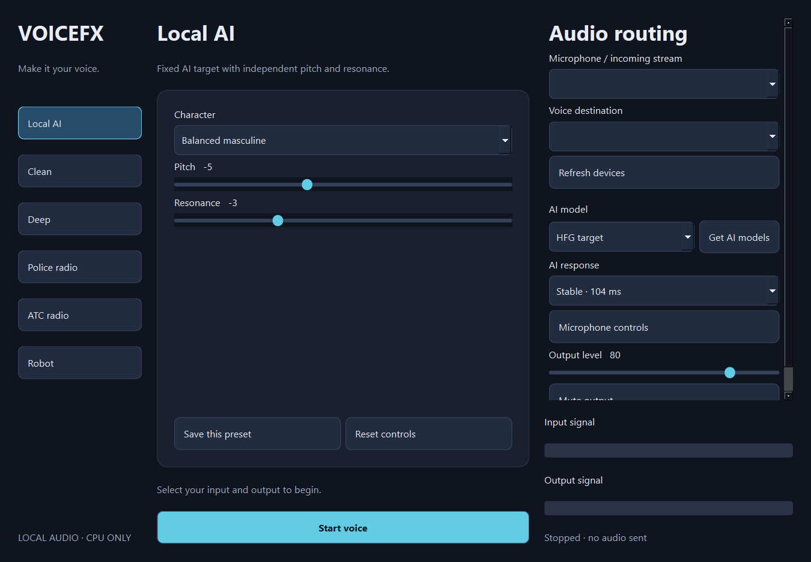

# VoiceFX

Local Windows voice changer with a single desktop interface. CPU only, no account,
cloud processing, voice uploads, or recording. Built for virtual audio routing,
including a second computer running the effects while the gaming PC runs FiveM.

**Modes:** clean, deep, gritty police radio, ATC radio, robot, and LLVC AI.
Separate pitch and resonance controls shape the AI voice; each mode has a saved
preset. Shared gain, gate, output level, mute, device selectors and live meters.



## Run

Download the Windows release, extract it and open `VoiceFX.exe`.
Choose the input and output explicitly, then Start voice. AI models are optional:
use **Get AI models** once (about 80 MB). Processing then works offline.
Settings and models stay in your local application data folder, outside this repo.
Nothing starts listening automatically.

From source, install Python 3.12 and a 64-bit MinGW C++ compiler or Zig 0.14.1, then:

```powershell
powershell -ExecutionPolicy Bypass -File .\Setup.ps1 -AI
.\Start-VoiceFX.cmd
```

Omit `-AI` for native effects only. To build the portable Windows app, run
`Build.ps1` after setup with AI installed. No GPU or CUDA dependency.

## Routing and safe listening

Start with headphones and low output volume. Select a real microphone or a
virtual capture bus as input, and a separate playback device as output. Do not
route the processed output back into its input bus. Use Clean to check the route,
then choose an effect. Stop before changing modes or devices.

For a two-PC Voicemeeter/VBAN setup:

`PC raw mic → VBAN Mic → laptop capture bus → VoiceFX → AUX playback → dedicated outgoing VBAN bus → PC spare input → game mic bus`

For the common Banana arrangement, select **Voicemeeter Out B2** as laptop input
and **Voicemeeter AUX Input** as output. Route incoming raw mic to B2 only;
route AUX to A3 only; send A3 as FXMIC. On the PC, receive FXMIC on a spare input
and send that input to B1 for the game. Disable raw mic routing to B1 and disable
all other strips feeding that game bus. Keep existing unrelated VBAN streams.
Monitoring FXMIC through the PC headset is useful for testing; avoid also
monitoring the raw microphone or you will hear a double voice. This app never
changes Voicemeeter configuration.

## Performance and troubleshooting

Native effects use 20 ms chunks. AI defaults to stable 104 ms chunks, with two
chunks of scheduling headroom plus 64 ms character processing. Driver, VBAN,
network and game buffers add further delay. Chunk size is **not** total latency.
Beatrice voices first check 50 ms chunks through the official VST3 and fall back
to 100 ms chunks if needed; the response menu does not change their block size.
The desktop offline benchmark does not predict XPS performance or end-to-end
game latency.
The MME driver requests a conservative 120 ms buffer for reliable virtual routing.
Experimental 52 ms AI may stop on a busy laptop. Measure the full round trip by
recording a clap/reference sound and the returned headphone signal, then compare
their onsets; lower driver/VBAN buffers only while audio remains reliable.

The app benchmarks AI before opening audio. Fixed playback deadlines and bounded
queues prevent increasing delay after a stall. Repeated misses or device loss
stop output; there is no automatic raw microphone fallback. Re-select devices
after reconnecting. A muted input meter suggests the wrong capture bus, gain or
Voicemeeter routing; an active output meter with no sound suggests output routing.
Run only one VoiceFX audio session at a time.

LLVC uses a fixed learned target voice, originally feminine. The masculine and
deep controls reshape that target; they are not separate trained male voices.
Effects cannot guarantee that acquaintances will not recognize your voice.
Use your own judgment and server rules when using voice effects.

## Development

For separate desktop GPU training and the custom LLVC model path, see
[Offline custom voice training](training/README.md). The training preflight is
independent of the CPU-only real-time app and does not change audio routing.

The separately trained [Beatrice v2 pilot voices](models/beatrice/README.md)
include listening previews and reproducibility details. To use them in VoiceFX,
install the official Beatrice v2 Windows VST3 separately into
`%LOCALAPPDATA%\VoiceFX\plugins` or the standard Windows VST3 folder. The
plug-in itself is not bundled with VoiceFX. When installed, Pop Smoke and Opie
appear in the AI model selector. They use 50 or 100 ms streaming blocks with the same
selected input, output, and optional headphone monitor as other modes. Changing
voices requires stopping audio first. XPS live performance remains untested.

```powershell
.venv\Scripts\python.exe tests\test_dsp.py
.venv\Scripts\python.exe tests\test_character.py
.venv\Scripts\python.exe tests\test_audio.py
```

MIT for the application and native DSP. Third-party licenses and pinned source
revisions are listed in [THIRD-PARTY.md](THIRD-PARTY.md). The Windows interface
uses dynamically linked PySide6/Qt under LGPLv3; its library licenses travel with
the release. Portable builds including Pedalboard also include its GPLv3 license
and dependency notices. Contributions welcome. Windows 10/11, 64-bit; other platforms are
not currently supported.

## Self-monitoring

Choose an optional headphone device separate from the voice destination before
starting. **Hear myself** turns VoiceFX's own headphone feed on or off while
the voice destination continues. Monitoring starts off each time the app opens.
**Mute output** still silences the voice destination.

This control does not change Voicemeeter or VBAN routing. If Voicemeeter itself
already sends your voice to your headphones, that external playback remains.

## Custom CPU models

When a trained LLVC checkpoint has passed quality and CPU performance checks,
put it in the local `VoiceFX/models` data folder as `pop-smoke-llvc.pth` or
`opie-llvc.pth`. Record its lowercase SHA-256 checksum in
`custom-models.json` under the matching `pop_smoke` or `opie` key. The app then
shows it in the AI model selector. It checks the checksum and loads weights
strictly against the existing LLVC architecture; an RVC training checkpoint
cannot be used there. The built-in models retain their original checksums.
